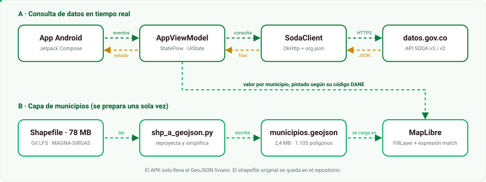
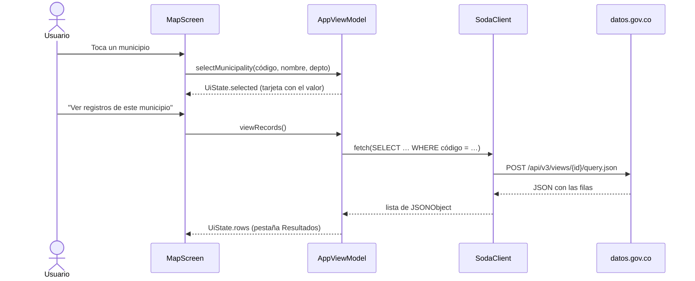
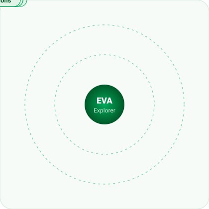
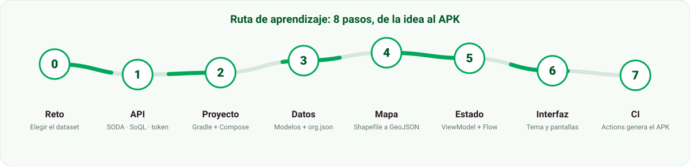
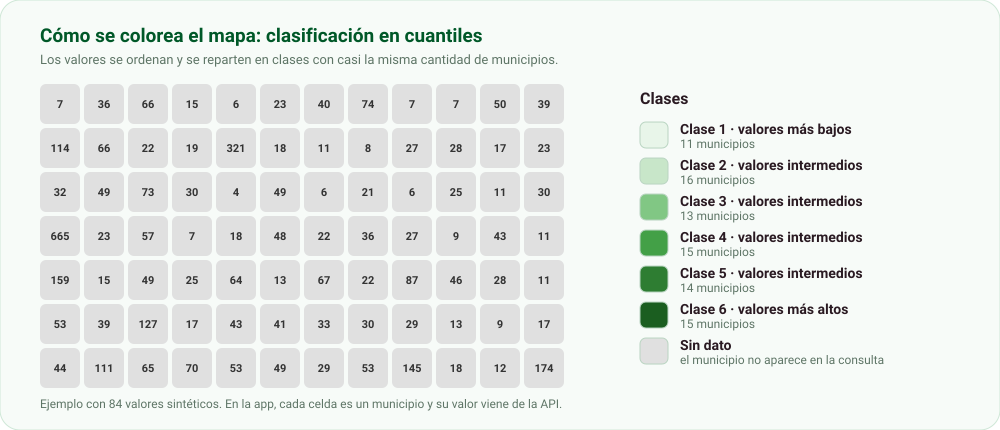

<div align="center">




<br/>

[](https://github.com/jf-floresriera/Reto10/actions/workflows/build-apk.yml)


</div>


**EVA Explorer** es una aplicación Android que lleva los datos abiertos del Estado colombiano a un **mapa interactivo**: pide a [datos.gov.co](https://www.datos.gov.co) las *Evaluaciones Agropecuarias Municipales (EVA)*, las agrupa por municipio y pinta cada uno de los 1.105 polígonos según el valor que elijas (producción, área sembrada, rendimiento…). Además permite **consultar todas las columnas** del dataset con filtros, orden y paginación.

Pero este repositorio es también una **guía de estudio**. Cada parte del proyecto se explica en detalle: qué hace, qué parámetros usa, por qué se tomó cada decisión y cómo se construyó, paso a paso, desde la idea hasta un APK compilado automáticamente en GitHub. Si quieres aprender a desarrollar una app Android real que consume una API pública y dibuja un mapa, esta guía está pensada para ti.

> [!NOTE]
> **Estado del proyecto (léelo primero).** La app **compila en GitHub Actions** y el GeoJSON de municipios está **validado** (1.105 municipios, códigos únicos de 5 dígitos).

---

## Cómo usar esta guía

| Si quieres… | Ve a… |
|---|---|
| Entender qué hace la app y cómo encajan sus piezas | [1. El reto](#reto) · [2. Vista general](#vista) · [3. Stack](#stack) · [4. Estructura](#estructura) |
| **Aprender construyéndola** | [5. Ruta de desarrollo paso a paso](#ruta) (8 pasos) |
| Buscar el significado de un parámetro | [6. Referencia de parámetros](#parametros) |
| Instalarla o compilarla | [7. Cómo ejecutar](#ejecutar) |
| Resolver un error | [8. Solución de problemas](#problemas) |
| Practicar | [10. Ejercicios propuestos](#ejercicios) |

**Qué aprenderás:** Kotlin y Jetpack Compose · consumo de APIs REST con OkHttp · JSON con `org.json` del SDK de Android · consultas SoQL · corrutinas y `StateFlow` · patrón ViewModel · sistemas de coordenadas y GeoJSON · mapas con MapLibre y mapas coropléticos · Gradle · Git LFS · integración continua con GitHub Actions · buenas prácticas básicas de seguridad.

**Cómo están organizados los pasos.** Cada paso de la sección 5 usa los mismos bloques para que sea fácil estudiarlo:

| Bloque | Contenido |
|---|---|
| 🎯 **Objetivo** | Qué lograrás en ese paso |
| 🧠 **Concepto** | La idea que debes entender antes de mirar el código |
| 💻 **Código** | Fragmentos reales del repositorio, copiados tal cual |
| ⚙️ **Parámetros** | Qué significa cada valor importante |
| ⚠️ **Errores comunes** | Dónde suele fallar |
| ✅ **Compruébalo** | Cómo verificar que el paso funciona |


## Índice

1. [El reto y qué construimos](#reto)
2. [Vista general: cómo fluyen los datos](#vista)
3. [Stack tecnológico y por qué cada pieza](#stack)
4. [Estructura del repositorio](#estructura)
5. [Ruta de desarrollo paso a paso](#ruta)
   - [Paso 0 · Entender el reto y elegir los datos](#paso-0)
   - [Paso 1 · Entender la API SODA](#paso-1)
   - [Paso 2 · Crear el proyecto Android con Gradle](#paso-2)
   - [Paso 3 · La capa de datos: modelos, SoQL y cliente HTTP](#paso-3)
   - [Paso 4 · La capa de municipios: del shapefile al GeoJSON](#paso-4)
   - [Paso 5 · El mapa con MapLibre](#paso-5)
   - [Paso 6 · El estado de la app: ViewModel y StateFlow](#paso-6)
   - [Paso 7 · La interfaz con Jetpack Compose](#paso-7)
   - [Paso 8 · Compilación continua con GitHub Actions](#paso-8)
6. [Referencia de parámetros](#parametros)
7. [Cómo ejecutar el proyecto](#ejecutar)
8. [Solución de problemas](#problemas)
9. [Decisiones de diseño y compromisos](#decisiones)
10. [Ejercicios propuestos](#ejercicios)
11. [Glosario](#glosario)
12. [Estado y limitaciones conocidas](#estado)
13. [Referencias y créditos](#referencias)


<a id="reto"></a>
## 1. El reto y qué construimos

El **Reto 10** del curso *Desarrollo de Aplicaciones para Dispositivos Móviles* pide construir una app Android que consuma un servicio web publicado en el Catálogo de Datos Colombiano, con una interfaz que permita **enviar parámetros** al servicio y **mostrar la respuesta**, procesando el JSON con el objeto que ofrece el SDK de Android.

| Requisito del enunciado | Cómo se cumple aquí | Dónde verlo |
|---|---|---|
| Consumir un servicio web del catálogo de datos abiertos | API SODA de datos.gov.co sobre el dataset EVA | [`data/SodaClient.kt`](app/src/main/java/io/github/jfloresriera/reto10/data/SodaClient.kt) |
| Interfaz gráfica para **enviar parámetros** | Constructor de filtros por columna, selección de columnas, orden, y ajustes del mapa | [`ui/screens/QueryScreen.kt`](app/src/main/java/io/github/jfloresriera/reto10/ui/screens/QueryScreen.kt) |
| **Presentar la respuesta** del servicio | Mapa coroplético y lista de registros con todas las columnas | [`MapScreen.kt`](app/src/main/java/io/github/jfloresriera/reto10/ui/screens/MapScreen.kt) · [`ResultsScreen.kt`](app/src/main/java/io/github/jfloresriera/reto10/ui/screens/ResultsScreen.kt) |
| Usar el **objeto JSON del SDK de Android** | `org.json.JSONObject` y `JSONArray`, sin librerías de terceros para JSON | [`SodaClient.kt`](app/src/main/java/io/github/jfloresriera/reto10/data/SodaClient.kt) · [`AppViewModel.kt`](app/src/main/java/io/github/jfloresriera/reto10/AppViewModel.kt) |

### ¿Qué son las EVA?

Las **Evaluaciones Agropecuarias Municipales (EVA)** son la base de información sobre la oferta productiva agropecuaria de los municipios del país: área sembrada, área cosechada, producción y rendimiento por cultivo y año. La publica la UPRA y está disponible como dato abierto ([más información en UPRA](https://upra.gov.co/es-co/eva)).

Este proyecto trabaja con dos conjuntos publicados en datos.gov.co:

| Identificador | Contenido | Estado de verificación |
|---|---|---|
| `2pnw-mmge` | EVA 2007–2018 | Identificador citado en [una publicación pública](https://rstudio-pubs-static.s3.amazonaws.com/1221100_4f94566450c3430bbc40e63eda436781.html) 🟡 |
| `uejq-wxrr` | EVA 2019–2023 | Mismo origen; 🟡 por confirmar |

La app **no depende de estos dos**: acepta cualquier identificador de datos.gov.co con formato `xxxx-xxxx`. Lee las columnas del dataset en tiempo de ejecución, así que el mismo código sirve para otros conjuntos con código de municipio.

<a id="vista"></a>
## 2. Vista general: cómo fluyen los datos

<div align="center">

</div>

La app tiene **dos carriles** que se encuentran en el mapa:

- **Carril A (tiempo real).** La interfaz envía eventos al `AppViewModel`; este arma una consulta SoQL y la entrega a `SodaClient`, que la envía por HTTPS a datos.gov.co. La respuesta JSON se procesa con `org.json`, se convierte en estado (`UiState`) y la interfaz se redibuja sola.
- **Carril B (se prepara una sola vez).** El shapefile oficial de municipios (78 MB) es demasiado pesado para un teléfono. Un script lo reproyecta, lo simplifica y lo convierte en un GeoJSON de 2,4 MB que viaja dentro del APK. MapLibre lo dibuja con la GPU.
- **El punto de encuentro** es el **código DANE del municipio** (5 dígitos, por ejemplo `05001` para Medellín). Los datos de la API traen ese código; cada polígono del GeoJSON también. Así se sabe qué color corresponde a cada polígono.

### Flujo de una interacción: tocar un municipio



### Flujo de datos de un solo sentido

La app sigue el patrón **flujo de datos unidireccional**: los *eventos* suben (el usuario toca algo), el *estado* baja (el `ViewModel` publica un `UiState` nuevo). La interfaz nunca modifica los datos por su cuenta; solo los muestra y avisa al `ViewModel`. Esto hace que el comportamiento sea predecible y fácil de depurar.

<a id="stack"></a>
## 3. Stack tecnológico y por qué cada pieza



El proyecto usa solo lo necesario. Cada fila de la tabla responde a: *¿qué hace?* y *¿por qué esta y no otra?*

<br clear="right"/>

### Plataforma y compilación

| Pieza | Versión | Para qué sirve | Por qué esta |
|---|---|---|---|
| **Kotlin** | 2.0.21 | Lenguaje de la app | Lenguaje oficial para Android; es el mismo de los retos anteriores |
| **Android Gradle Plugin** | 8.7.3 | Compila el proyecto y genera el APK | Versión estable compatible con Gradle 8.9 y `compileSdk 35` |
| **Gradle (wrapper)** | 8.9 | Sistema de construcción | El *wrapper* descarga la versión exacta: no necesitas instalar Gradle |
| **JDK** | 17 | Compilar el código | Requisito de AGP 8.x |
| **compileSdk / targetSdk / minSdk** | 35 / 34 / 26 | Contra qué API se compila, para cuál se diseña y la mínima que se soporta | `minSdk 26` (Android 8.0) cubre casi todos los teléfonos activos; `targetSdk 34` evita el modo de pantalla completa obligatorio de Android 15 (ver [sección 9](#decisiones)) |

### Interfaz y estado

| Pieza | Versión | Para qué sirve | Por qué esta |
|---|---|---|---|
| **Jetpack Compose** (BOM) | 2024.09.00 | Interfaz declarativa en Kotlin | Sin archivos XML de diseño; la UI es una función del estado. Es el mismo enfoque de GulupaScan |
| **Material 3** | (vía BOM) | Componentes visuales (botones, barras, diálogos) | Diseño moderno y accesible ya resuelto |
| **material-icons-extended** | (vía BOM) | Iconos | Evita dibujar iconos propios |
| **activity-compose** | 1.9.1 | Conecta Compose con la `Activity` (`setContent`) | Necesario para usar Compose |
| **lifecycle-runtime-compose** | 2.8.4 | `collectAsStateWithLifecycle()` | Deja de escuchar el estado cuando la app no está visible |
| **lifecycle-viewmodel-compose** | 2.8.4 | `ViewModel` que sobrevive a rotaciones | El estado no se pierde al girar la pantalla |
| **kotlinx-coroutines-android** | 1.8.1 | Trabajo asíncrono (red sin bloquear la interfaz) | Estándar de Kotlin para concurrencia |

### Datos y mapa

| Pieza | Versión | Para qué sirve | Por qué esta |
|---|---|---|---|
| **OkHttp** | 4.12.0 | Cliente HTTP (GET y POST, tiempos de espera) | Más simple y completo que `HttpURLConnection` |
| **org.json** | (incluido en Android) | `JSONObject` y `JSONArray` | **Lo exige el enunciado**; no añade dependencias |
| **MapLibre Native Android** | 13.0.0 | Mapa vectorial acelerado por GPU | Dibuja 1.105 polígonos con fluidez; es de código abierto y no requiere clave de API |
| **API SODA** (Socrata) | v3 y v2 | Servicio web de datos.gov.co | Es el que publica el catálogo |
| **GeoJSON** | — | Formato de la capa de municipios | Lo entiende MapLibre directamente |

### Herramientas de apoyo

| Pieza | Para qué sirve |
|---|---|
| **Python 3 + geopandas + shapely + pyogrio** | Convertir el shapefile en GeoJSON ([`tools/shp_a_geojson.py`](tools/shp_a_geojson.py)) |
| **Git LFS** | Guardar el shapefile de 78 MB sin inflar el historial de Git |
| **GitHub Actions** | Compilar el APK automáticamente en cada cambio |

> [!TIP]
> **¿Por qué no Google Maps?** Necesita una clave de API asociada a una cuenta. MapLibre no la necesita, y como el mapa de este proyecto es un fondo liso con polígonos, tampoco requiere servidor de teselas ni conexión para dibujar la capa.

<a id="estructura"></a>
## 4. Estructura del repositorio

```text
Reto10/
├── app/
│   ├── build.gradle.kts                  ← dependencias, versiones y token (BuildConfig)
│   └── src/main/
│       ├── AndroidManifest.xml           ← permisos y actividad de entrada
│       ├── assets/municipios.geojson     ← capa de 1.105 municipios (2,4 MB)
│       ├── res/                          ← ícono, tema base, textos
│       └── java/io/github/jfloresriera/reto10/
│           ├── MainActivity.kt           ← punto de entrada + navegación entre pestañas
│           ├── AppViewModel.kt           ← estado de toda la app (UiState)
│           ├── data/
│           │   ├── Models.kt             ← DataColumn, Filter, Op, Agg, Settings…
│           │   ├── Soql.kt               ← construye consultas SoQL de forma segura
│           │   ├── SodaClient.kt         ← cliente HTTP + procesamiento JSON (org.json)
│           │   ├── Prefs.kt              ← guarda los ajustes en el teléfono
│           │   └── MunicipalityLayer.kt  ← lee los códigos de la capa sin cargar la geometría
│           ├── domain/
│           │   └── Choropleth.kt         ← clasificación en cuantiles y colores
│           └── ui/
│               ├── theme/Theme.kt        ← colores de marca (verde / morado)
│               ├── components/Components.kt  ← tarjetas, botones, listas desplegables
│               └── screens/              ← Mapa, Consultar, Resultados, Ajustes
├── data/raw/municipios_shp/              ← shapefile original (Git LFS, 78 MB)
├── tools/
│   ├── shp_a_geojson.py                  ← shapefile → GeoJSON liviano
│   ├── generar_svg_readme.py             ← genera las animaciones de este README
│   └── requirements.txt                  ← dependencias de Python
├── assets/                               ← animaciones SVG del README
├── .github/workflows/build-apk.yml       ← compilación automática del APK
├── build.gradle.kts · settings.gradle.kts · gradle.properties
└── gradlew · gradlew.bat · gradle/wrapper/   ← Gradle Wrapper
```

El código sigue una separación en tres capas. Cada archivo se puede leer sin entender los demás:

| Capa | Carpeta | Responsabilidad | Depende de |
|---|---|---|---|
| **Datos** | `data/` | Hablar con la API y con el teléfono; no sabe nada de pantallas | Solo del SDK y OkHttp |
| **Dominio** | `domain/` | Reglas de negocio puras (clasificar valores en colores) | Nada de Android |
| **Interfaz** | `ui/` y `MainActivity.kt` | Dibujar y capturar eventos; no hace red ni cálculos | `AppViewModel` |

El `AppViewModel` queda en medio: coordina las tres capas y es la única fuente de verdad del estado.


<a id="ruta"></a>
## 5. Ruta de desarrollo paso a paso

<div align="center">

</div>

Sigue los pasos en orden. Cada uno construye sobre el anterior y deja algo que puedes comprobar.

<a id="paso-0"></a>
### Paso 0 · Entender el reto y elegir los datos

🎯 **Objetivo.** Decidir qué dataset usar y comprobar que sirve para el proyecto.

🧠 **Concepto.** Un buen dataset para una app con mapa cumple cuatro condiciones:

1. **Tiene una clave geográfica**: aquí, el código de municipio.
2. **Tiene al menos una variable numérica** para colorear (producción, área…).
3. **Está publicado con API**, no solo como archivo para descargar.
4. **Se mantiene actualizado** y tiene licencia abierta.

Las EVA cumplen las cuatro. Además hay una razón práctica: la clave (el código DANE) es la misma que usa la capa de límites municipales, y eso permite unir datos y mapa sin geocodificar nada.

⚠️ **Errores comunes.** Elegir un dataset sin clave geográfica (después no hay cómo ubicarlo) o con el nombre del municipio como única clave (los nombres se repiten y tienen tildes; el código no).

✅ **Compruébalo.** Abre `https://www.datos.gov.co/api/views/2pnw-mmge.json` en el navegador. Debe aparecer un JSON con el nombre del dataset y una lista `columns`. Ahí verás los nombres reales de las columnas, que la app también lee al iniciar.

<a id="paso-1"></a>
### Paso 1 · Entender la API SODA

🎯 **Objetivo.** Saber pedir datos a datos.gov.co desde la terminal antes de escribir una línea de Kotlin.

🧠 **Concepto.** datos.gov.co está construido sobre **Socrata**, que publica cada dataset con un **identificador de 8 caracteres** (`2pnw-mmge`, llamado "4x4") y una API llamada **SODA**. Hay dos generaciones de consulta:

| | **SODA v2** | **SODA v3** |
|---|---|---|
| Petición | `GET /resource/{id}.json?$query=…` | `POST /api/v3/views/{id}/query.json` con cuerpo JSON |
| Token | Opcional (sin él, el límite de peticiones es menor) | **Obligatorio**: autenticación o *app token* |
| Paginación | `LIMIT` y `OFFSET` dentro de la consulta | Objeto `page` (`pageNumber`, `pageSize`) |
| Lenguaje de consulta | SoQL | SoQL |

Según la [documentación de Socrata](https://dev.socrata.com/docs/queries/), SODA3 exige que las peticiones estén autenticadas o lleven un *app token* válido, y recomienda usar `POST`. El token **identifica a tu aplicación**; no es una contraseña. Se crea gratis en tu cuenta de datos.gov.co (busca "Developer Settings" o "Configuración de desarrollador"; la ruta exacta del menú puede cambiar). Más información: [App Tokens](https://dev.socrata.com/docs/app-tokens).

**SoQL** es un lenguaje parecido a SQL. Las cuatro cláusulas que usa la app:

| Cláusula | Qué hace | Ejemplo |
|---|---|---|
| `SELECT` | Elige columnas o calcula agregados | `SELECT municipio, SUM(produccion)` |
| `WHERE` | Filtra filas | `WHERE upper(departamento) = 'META'` |
| `GROUP BY` | Agrupa para agregar | `GROUP BY municipio` |
| `ORDER BY` | Ordena | `ORDER BY produccion DESC` |

💻 **Código.** Estas tres peticiones son las que la app hace internamente. Pruébalas en tu terminal (reemplaza `TU_TOKEN`):

```bash
# 1) Metadatos: nombres, etiquetas y tipos de las columnas
curl -s "https://www.datos.gov.co/api/views/2pnw-mmge.json" | python3 -m json.tool | head -60

# 2) API v3 (con token): 5 filas, primera página
curl -s -X POST "https://www.datos.gov.co/api/v3/views/2pnw-mmge/query.json" \
  -H "X-App-Token: TU_TOKEN" -H "Content-Type: application/json" \
  -d '{"query":"SELECT *","page":{"pageNumber":1,"pageSize":5},"includeSynthetic":false}'

# 3) API v2 (sin token): la paginación va dentro del texto de la consulta
curl -s -G "https://www.datos.gov.co/resource/2pnw-mmge.json" \
  --data-urlencode '$query=SELECT * LIMIT 5 OFFSET 0'
```

⚙️ **Parámetros.**

| Elemento | Significado |
|---|---|
| `X-App-Token` | Encabezado HTTP con tu token |
| `query` | Texto SoQL que se ejecuta |
| `page.pageNumber` | Número de página; la app lo calcula como `offset / limit + 1` (asume que empieza en 1 🟡) |
| `page.pageSize` | Filas por página |
| `includeSynthetic` | La app lo envía en `false` |
| `$query` (v2) | Parámetro URL con la consulta; el `$` hay que escaparlo en la terminal |

⚠️ **Errores comunes.** `401`/`403`: falta el token o es inválido. `404`: el identificador no existe. `400`: la consulta SoQL tiene un error (una columna mal escrita). `429`: demasiadas peticiones sin token.

✅ **Compruébalo.** La petición 3 debe devolver un arreglo JSON con 5 objetos. Si la petición 2 funciona, tu token es válido.

> [!NOTE]
> Los ejemplos con el cuerpo `{"query":…,"page":…}` siguen la documentación de Socrata, pero **no los he podido ejecutar contra datos.gov.co desde el entorno de desarrollo** 🟡. Si alguna falla en tu terminal, el mensaje de error indica qué ajustar; la app incluye el modo v2 como respaldo.

<a id="paso-2"></a>
### Paso 2 · Crear el proyecto Android con Gradle

🎯 **Objetivo.** Tener un proyecto que compile y genere un APK vacío.

🧠 **Concepto.** Android usa **Gradle** para compilar. Hay tres archivos de configuración:

| Archivo | Rol |
|---|---|
| `settings.gradle.kts` | Nombre del proyecto, módulos (`:app`) y de dónde descargar dependencias |
| `build.gradle.kts` (raíz) | Declara los *plugins* y sus versiones, sin aplicarlos |
| `app/build.gradle.kts` | Configura el módulo: SDK, dependencias y opciones de compilación |

El **Gradle Wrapper** (`gradlew` y la carpeta `gradle/wrapper/`) descarga la versión exacta de Gradle (8.9). Por eso cualquiera, incluido el servidor de GitHub, compila igual sin instalar nada.

💻 **Código.** Los plugins, con sus versiones, en [`build.gradle.kts`](build.gradle.kts):

<!-- src: build.gradle.kts -->
```kotlin
plugins {
    id("com.android.application") version "8.7.3" apply false
    id("org.jetbrains.kotlin.android") version "2.0.21" apply false
    id("org.jetbrains.kotlin.plugin.compose") version "2.0.21" apply false
}
```

Las opciones del módulo, en [`app/build.gradle.kts`](app/build.gradle.kts):

<!-- src: app/build.gradle.kts -->
```kotlin
android {
    namespace = "io.github.jfloresriera.reto10"
    compileSdk = 35

    defaultConfig {
        // No usar "com.example.*": algunos servicios bloquean ese identificador.
        applicationId = "io.github.jfloresriera.reto10"
        minSdk = 26
        targetSdk = 34
        versionCode = 1
        versionName = "1.0.0"

        buildConfigField("String", "DATOS_APP_TOKEN", "\"$appToken\"")
    }
```

**El token sin escribirlo en el código.** Gradle lo lee de `local.properties` (archivo ignorado por Git) o de una variable de entorno (el secreto de GitHub), y lo convierte en una constante de la clase `BuildConfig`:

<!-- src: app/build.gradle.kts -->
```kotlin
val localProps = Properties().apply {
    val f = rootProject.file("local.properties")
    if (f.exists()) f.inputStream().use { load(it) }
}
val appToken: String = (localProps.getProperty("datos.appToken") ?: System.getenv("DATOS_APP_TOKEN") ?: "")
    .filter { it.isLetterOrDigit() }
```

⚙️ **Parámetros.**

| Parámetro | Valor | Qué significa |
|---|---|---|
| `namespace` | `io.github.jfloresriera.reto10` | Paquete donde Gradle genera `R` y `BuildConfig` |
| `applicationId` | igual | Identificador único de la app en el teléfono y en Google Play |
| `compileSdk` | 35 | API de Android contra la que se compila (da acceso a las funciones más nuevas) |
| `targetSdk` | 34 | Versión para la que se diseñó y probó el comportamiento |
| `minSdk` | 26 | Android 8.0, la mínima en la que la app se puede instalar |
| `versionCode` | 1 | Número entero que **debe subir** en cada versión publicada |
| `.filter { it.isLetterOrDigit() }` | — | Deja solo letras y números. Así un token mal pegado no puede romper el código Java generado |

Dependencias, resumidas (las versiones completas están en la [sección 3](#stack)):

<!-- src: app/build.gradle.kts -->
```kotlin
    // Red (el JSON se procesa con org.json, que viene en el SDK de Android)
    implementation("com.squareup.okhttp3:okhttp:4.12.0")

    // Mapa vectorial acelerado por GPU (capa coroplética de municipios)
    implementation("org.maplibre.gl:android-sdk:13.0.0")
```

**El manifiesto** declara lo que la app necesita del sistema. Solo pide `INTERNET` y `ACCESS_NETWORK_STATE`. Tiene `android:allowBackup="false"`: así el token guardado en el teléfono no se copia a la nube con las copias de seguridad.

⚠️ **Errores comunes.**
- Usar un `applicationId` que empiece por `com.example`: algunos servicios (como OpenStreetMap) bloquean esos identificadores de ejemplo.
- Olvidar subir `versionCode`: Android puede negarse a reemplazar una versión instalada por otra con el mismo número.
- Mezclar versiones de Kotlin y del plugin de Compose: deben coincidir (aquí, ambas `2.0.21`).

✅ **Compruébalo.** `./gradlew assembleDebug` debe terminar con `BUILD SUCCESSFUL` y dejar el APK en `app/build/outputs/apk/debug/`.

<a id="paso-3"></a>
### Paso 3 · La capa de datos: modelos, SoQL y cliente HTTP

🎯 **Objetivo.** Poder pedir filas a la API desde Kotlin y recibirlas como objetos.

🧠 **Concepto.** Esta capa no sabe nada de pantallas. Tiene tres piezas:

1. **Modelos** (`Models.kt`): clases de datos que representan una columna, un filtro, una operación.
2. **`Soql`**: convierte filtros en texto SoQL **de forma segura**.
3. **`SodaClient`**: envía la petición HTTP y convierte la respuesta en `JSONObject`.

#### 3.1 Modelos

Un `DataColumn` describe una columna con su nombre técnico (`fieldName`), su etiqueta legible y su tipo. El tipo decide qué operaciones tienen sentido: "contiene" para texto, "mayor que" para números.

<!-- src: app/src/main/java/io/github/jfloresriera/reto10/data/Models.kt -->
```kotlin
enum class Op(val label: String) {
    EQ("igual a"),
    NE("distinto de"),
    CONTAINS("contiene"),
    GT("mayor que"),
    GTE("mayor o igual que"),
    LT("menor que"),
    LTE("menor o igual que");

    companion object {
        fun forColumn(c: DataColumn): List<Op> = when {
            c.isText -> listOf(EQ, CONTAINS, NE)
            else -> listOf(EQ, NE, GT, GTE, LT, LTE)
        }
    }
}
```

#### 3.2 `Soql`: construir consultas sin abrir puertas

🧠 **Concepto: inyección.** La app arma texto de consulta con datos que vienen del usuario (el valor de un filtro) y de la red (el nombre de una columna). Si pegara ese texto sin cuidado, alguien podría escribir un valor que **cambie el sentido de la consulta**. Es el mismo problema de la *inyección SQL*. Las dos defensas son:

1. **Validar identificadores**: un nombre de columna solo puede tener letras, números y guion bajo.
2. **Escapar valores**: las comillas simples se duplican (`'` → `''`) y todo valor va entre comillas.

<!-- src: app/src/main/java/io/github/jfloresriera/reto10/data/Soql.kt -->
```kotlin
    private val IDENT = Regex("^[A-Za-z_][A-Za-z0-9_]*$")
    private val NUMBER = Regex("^-?\\d+(\\.\\d+)?$")

    fun ident(name: String): String {
        require(IDENT.matches(name)) { "Nombre de columna no válido: $name" }
        return name
    }

    fun quote(value: String): String = "'" + value.replace("'", "''") + "'"
```

Para los filtros numéricos no se usan comillas: se exige que el valor tenga forma de número. Para los de texto se compara en mayúsculas, así `meta`, `Meta` y `META` dan el mismo resultado:

<!-- src: app/src/main/java/io/github/jfloresriera/reto10/data/Soql.kt -->
```kotlin
        if (f.column.isNumeric) {
            require(f.op != Op.CONTAINS) { "«contiene» no aplica a la columna numérica «${f.column.label}»." }
            val n = raw.replace(',', '.')
            require(NUMBER.matches(n)) { "«$raw» no es un número válido para «${f.column.label}»." }
            return "$col ${symbol(f.op)} $n"
        }
        return when (f.op) {
            Op.CONTAINS -> "upper($col) LIKE ${quote("%" + raw.uppercase() + "%")}"
```

**Ejemplos de lo que genera** (los nombres de columna son ilustrativos; la app usa los reales del dataset):

| Acción en la interfaz | SoQL resultante |
|---|---|
| Filtro texto: Departamento *igual a* `meta` | `upper(departamento) = 'META'` |
| Filtro texto: Cultivo *contiene* `caucho` | `upper(cultivo) LIKE '%CAUCHO%'` |
| Filtro número: Año *mayor o igual que* `2015` | `anio >= 2015` |
| Valor con comilla: `O'Higgins` | `upper(cultivo) = 'O''HIGGINS'` |
| Mapa: sumar producción por municipio | `SELECT cod_municipio AS cod, SUM(produccion) AS valor GROUP BY cod_municipio ORDER BY cod_municipio` |

#### 3.3 `SodaClient`: la petición y el JSON

Esta es la parte central del reto. El método decide entre v3 y v2 y arma la petición:

<!-- src: app/src/main/java/io/github/jfloresriera/reto10/data/SodaClient.kt -->
```kotlin
    private fun fetchBlocking(cfg: ApiConfig, id: String, soql: String, offset: Int, limit: Int): List<JSONObject> {
        val request = if (cfg.useV3) {
            if (cfg.token.isBlank()) {
                throw ApiException("La API v3 necesita un app token. Pégalo en Ajustes o cambia el modo a «v2 clásico».")
            }
            val body = JSONObject()
                .put("query", soql)
                .put("page", JSONObject().put("pageNumber", offset / limit + 1).put("pageSize", limit))
                .put("includeSynthetic", false)
            builder(cfg)
                .url("$HOST/api/v3/views/$id/query.json")
                .post(body.toString().toRequestBody(JSON_TYPE))
                .build()
        } else {
            val url = "$HOST/resource/$id.json".toHttpUrl().newBuilder()
                .addQueryParameter("\$query", "$soql LIMIT $limit OFFSET $offset")
                .build()
            builder(cfg).url(url).get().build()
        }
        return parseRows(execute(request))
    }
```

> [!IMPORTANT]
> **Aquí está el requisito del reto.** El cuerpo de la petición se construye con `JSONObject().put(…)` y la respuesta se recorre con `JSONArray` y `optJSONObject`. Son clases del SDK de Android (`org.json`); no se usa Gson ni `kotlinx.serialization`.

La respuesta puede ser un arreglo JSON, o un objeto que contenga el arreglo. `parseRows` acepta ambas formas y falla con un mensaje claro si no entiende el formato:

<!-- src: app/src/main/java/io/github/jfloresriera/reto10/data/SodaClient.kt -->
```kotlin
        val arr: JSONArray = try {
            if (t.startsWith("[")) JSONArray(t) else findArray(JSONObject(t))
        } catch (e: org.json.JSONException) {
            throw ApiException("La respuesta de datos.gov.co no es un JSON válido.")
        }
        val rows = (0 until arr.length()).mapNotNull { arr.optJSONObject(it) }
```

**Métodos de `org.json` que usa el proyecto:**

| Método | Qué hace | Por qué se prefiere |
|---|---|---|
| `JSONObject().put(clave, valor)` | Construye un objeto (devuelve el mismo objeto, se encadena) | Armar el cuerpo del POST |
| `JSONArray(texto)` / `JSONObject(texto)` | Interpreta un texto como JSON; lanza `JSONException` si es inválido | Procesar la respuesta |
| `optString(clave)` | Devuelve el texto, o `""` si no existe | `getString` lanzaría una excepción si falta la clave |
| `optJSONArray(clave)` · `optJSONObject(i)` | Devuelve el arreglo u objeto, o `null` | Tolerar respuestas incompletas |
| `keys()` | Recorre los nombres de las claves | Mostrar columnas que no estaban en los metadatos |
| `JSONObject.NULL` | Valor `null` de JSON | Distinguirlo de "clave ausente" |

La regla: **`opt…` para datos externos** (pueden venir incompletos), **`get…` solo cuando la ausencia sea un error de programación**.

#### 3.4 Corrutinas: la red nunca va en el hilo principal

Android prohíbe hacer red en el hilo principal (el que dibuja la pantalla). Por eso las funciones públicas son `suspend` y mueven el trabajo a `Dispatchers.IO`:

<!-- src: app/src/main/java/io/github/jfloresriera/reto10/data/SodaClient.kt -->
```kotlin
    suspend fun fetch(cfg: ApiConfig, datasetId: String, soql: String, offset: Int, limit: Int): List<JSONObject> =
        withContext(Dispatchers.IO) { fetchBlocking(cfg, checkId(datasetId), soql, offset, limit) }
```

Una función `suspend` puede **pausarse** sin bloquear el hilo y se reanuda cuando la red responde. Se invoca desde un `viewModelScope.launch { … }`, que se cancela solo cuando el `ViewModel` desaparece.

⚙️ **Parámetros del cliente.**

| Parámetro | Valor | Efecto |
|---|---|---|
| `connectTimeout` | 20 s | Tiempo máximo para establecer la conexión |
| `readTimeout` | 60 s | Tiempo máximo esperando datos (las agregaciones pueden tardar) |
| `writeTimeout` | 30 s | Tiempo máximo enviando la petición |
| Formato de identificador | `xxxx-xxxx` | Se valida con una expresión regular antes de armar la URL |

⚠️ **Errores comunes.**
- Hacer la petición sin `withContext(Dispatchers.IO)`: la app se cierra con `NetworkOnMainThreadException`.
- Concatenar el valor del usuario en la consulta sin escapar.
- Usar `getString` con datos externos: una clave ausente tumba la app.
- Olvidar cerrar la respuesta HTTP: el código usa `.use { … }`, que la cierra siempre.

✅ **Compruébalo.** Con el modo v2, la pestaña **Ajustes → Probar conexión** debe decir "Conexión correcta: N columnas leídas del dataset".

<a id="paso-4"></a>
### Paso 4 · La capa de municipios: del shapefile al GeoJSON

🎯 **Objetivo.** Convertir el shapefile oficial de 78 MB en una capa de 2,4 MB que un teléfono dibuje con fluidez.

🧠 **Concepto: por qué hay que transformar la capa.** Tres razones:

| Problema | Solución | Herramienta |
|---|---|---|
| El shapefile son **varios archivos** y MapLibre no lo lee | Convertir a **GeoJSON**, un único archivo de texto | `geopandas` |
| Está en un sistema **proyectado en metros** (MAGNA-SIRGAS 2018 / Origen Nacional, EPSG:9377) y el mapa usa **grados** (WGS84, EPSG:4326) | **Reproyectar** | `to_crs(4326)` |
| Tiene detalle excesivo: miles de vértices por municipio, invisibles en un teléfono | **Simplificar** los contornos | `simplify()` |

**¿Qué es un shapefile?** No es un archivo, sino un conjunto: `.shp` (las formas), `.shx` (índice), `.dbf` (la tabla de atributos), `.prj` (el sistema de coordenadas) y `.cpg` (la codificación de caracteres). Si falta alguno, el conjunto no sirve.

**¿Qué es un sistema de coordenadas (CRS)?** Una regla para convertir posiciones de la Tierra en números. En grados (latitud y longitud) un punto se ve como `-75.57, 6.25`; en metros proyectados, como `4 856 000, 2 187 000`. Mezclarlos desplaza todo. Por eso se lee el `.prj` y se reproyecta.

**¿Qué hace la simplificación?** El algoritmo de Douglas-Peucker elimina los vértices que se desvían menos que una **tolerancia** de la línea recta. Aquí la tolerancia es `0.002°`, unos 220 m (1° de latitud ≈ 111 km). A escala de país nadie nota la diferencia.

📊 **Resultado real con la capa de septiembre de 2026:**

| Medida | Valor |
|---|---|
| Municipios leídos | 1.105 (todos con código válido) |
| Geometrías | 1.100 `Polygon` y 5 `MultiPolygon` (municipios con islas) |
| Códigos únicos de 5 dígitos | 1.105, sin duplicados |
| Columnas del shapefile | `MpCodigo`, `MpNombre`, `MpArea`, `MpNorma`, `MpCategor`, `MpAltitud`, `Restriccio`, `Depto`, `SHAPE_Leng`, `SHAPE_Area` |
| Columnas que conserva el GeoJSON | `cod`, `nombre`, `depto` |
| Peso | 78 MB (`.shp`) → **2,4 MB** (GeoJSON) |

💻 **Código.** El núcleo del script [`tools/shp_a_geojson.py`](tools/shp_a_geojson.py) son tres líneas:

<!-- src: tools/shp_a_geojson.py -->
```python
    gdf = gdf[gdf.geometry.notna() & ~gdf.geometry.is_empty].to_crs(4326)
    gdf["geometry"] = gdf.geometry.simplify(a.tol, preserve_topology=True)
    gdf = gdf[~gdf.geometry.is_empty]
```

El código DANE se normaliza a 5 dígitos con ceros a la izquierda (`5001` → `05001`), porque es la clave que une el mapa con los datos:

<!-- src: tools/shp_a_geojson.py -->
```python
def normalizar_codigo(valor):
    """'5001', '05001' o '5001.0' -> '05001'. Devuelve '' si no se puede."""
    texto = str(valor).strip().split(".")[0]
    digitos = "".join(ch for ch in texto if ch.isdigit())
    if len(digitos) == 4:
        digitos = "0" + digitos
    return digitos if len(digitos) == 5 else ""
```

Y las coordenadas se redondean a 5 decimales (≈ 1 m), lo que adelgaza el archivo sin pérdida visible:

<!-- src: tools/shp_a_geojson.py -->
```python
def redondear(coords, decimales=5):
    """Redondea recursivamente las coordenadas y descarta la altura (Z) si existe."""
    if coords and isinstance(coords[0], (int, float)):
        return [round(coords[0], decimales), round(coords[1], decimales)]
    return [redondear(c, decimales) for c in coords]
```

▶️ **Cómo ejecutarlo** (Ubuntu, Zorin o Debian; el entorno virtual evita el error `externally-managed-environment`):

```bash
sudo apt install -y python3-venv python3-full
python3 -m venv .venv
source .venv/bin/activate
pip install -r tools/requirements.txt
python tools/shp_a_geojson.py
```

⚙️ **Parámetros del script.**

| Parámetro | Por defecto | Qué hace |
|---|---|---|
| `--entrada` | `data/raw/municipios_shp/Munpio.shp` | Shapefile de origen |
| `--salida` | `app/src/main/assets/municipios.geojson` | GeoJSON de destino |
| `--tol` | `0.002` | Tolerancia de simplificación en grados. Más alta = archivo más liviano y contornos más toscos |
| `--cod` | detectada | Columna con el código DANE. Se busca entre `MpCodigo`, `MPIO_CDPMP`, `COD_DANE`… |
| `--nombre` | detectada | Columna con el nombre del municipio |
| `--depto` | detectada | Columna con el departamento |

**Git LFS.** `.shp` y `.dbf` pesan casi 80 MB. Git guarda cada versión de cada archivo, así que un binario grande hace crecer el repositorio sin control. **Git LFS** deja en Git un *puntero* de 130 bytes y guarda el archivo real aparte. Las reglas están en `.gitattributes`:

```text
data/raw/municipios_shp/*.shp filter=lfs diff=lfs merge=lfs -text
data/raw/municipios_shp/*.dbf filter=lfs diff=lfs merge=lfs -text
```

> [!WARNING]
> **Limitación de la simplificación.** Cada municipio se simplifica por separado. En los bordes compartidos pueden aparecer rendijas o solapes mínimos entre vecinos. A la escala de la app son invisibles, y el contorno blanco de la capa de líneas los disimula. Herramientas como `mapshaper` simplifican con topología compartida si necesitas más fidelidad.

⚠️ **Errores comunes.**
- `externally-managed-environment` al usar `pip`: crea un entorno virtual (comandos arriba).
- `python: command not found`: en esas distribuciones el comando es `python3`.
- Mapa desplazado o vacío: el CRS no se reproyectó.
- Códigos con 4 dígitos (`5001`): sin el cero inicial no coinciden con los datos.

✅ **Compruébalo.** El script imprime `Municipios : 1105 (sin código válido: 0)` y el tamaño del archivo.

<a id="paso-5"></a>
### Paso 5 · El mapa con MapLibre

🎯 **Objetivo.** Dibujar los 1.105 municipios, colorearlos según los datos y reaccionar al toque.

🧠 **Concepto.** MapLibre dibuja el mapa a partir de un **estilo**: una descripción JSON de *fuentes* (de dónde vienen los datos) y *capas* (cómo se dibujan). Aquí el estilo base es solo un fondo liso:

<!-- src: app/src/main/java/io/github/jfloresriera/reto10/ui/screens/MapScreen.kt -->
```kotlin
/** Estilo mínimo: solo un fondo liso. El mapa funciona sin servidor de teselas ni conexión. */
private const val STYLE_JSON =
    """{"version":8,"name":"plano","sources":{},"layers":[{"id":"fondo","type":"background","paint":{"background-color":"#EAF1F6"}}]}"""
```

Sobre él se agregan **una fuente y tres capas**:

| Elemento | Tipo | Función |
|---|---|---|
| `mun-src` | `GeoJsonSource` | Carga `assets/municipios.geojson` |
| `mun-fill` | `FillLayer` | Rellena cada polígono con su color |
| `mun-line` | `LineLayer` | Borde blanco fino entre municipios |
| `mun-sel` | `LineLayer` | Contorno negro grueso del municipio seleccionado |

<!-- src: app/src/main/java/io/github/jfloresriera/reto10/ui/screens/MapScreen.kt -->
```kotlin
                if (MunicipalityLayer.exists(context)) {
                    style.addSource(GeoJsonSource(SRC, URI("asset://${MunicipalityLayer.ASSET}")))
                    style.addLayer(
                        FillLayer(FILL, SRC).withProperties(
                            PropertyFactory.fillColor("#E0E0E0"),
                            PropertyFactory.fillOpacity(0.95f),
                        ),
                    )
```

#### 5.1 Colorear según los datos: clasificación en cuantiles

<div align="center">

</div>

🧠 **Concepto: mapa coroplético.** Se pinta cada región con un color que depende de su valor. La decisión clave es **cómo repartir los valores en colores**. Con valores muy desiguales (pocos municipios producen muchísimo; la mayoría poco), un reparto en rangos iguales dejaría casi todo el mapa en un solo color. Los **cuantiles** reparten por cantidad: cada clase recibe aproximadamente el mismo número de municipios.

<!-- src: app/src/main/java/io/github/jfloresriera/reto10/domain/Choropleth.kt -->
```kotlin
        val sorted = values.values.sorted()
        val k = palette.size
        val thresholds = (1 until k)
            .map { sorted[(it * (sorted.size - 1)) / k] }
            .distinct()
        val classes = thresholds.size + 1
```

Paso a paso: (1) se ordenan los valores; (2) se toman los valores que están en las posiciones 1/6, 2/6… de la lista, que son los **umbrales**; (3) `distinct()` descarta umbrales repetidos (si hay muchos ceros, hay menos clases); (4) un municipio pertenece a la clase igual al número de umbrales que su valor alcanza o supera.

**Cómo se le dice a MapLibre qué color usar.** Se construye una *expresión* `match` que asocia grupos de códigos DANE con un color. Es JSON, así que se arma con `org.json`:

<!-- src: app/src/main/java/io/github/jfloresriera/reto10/domain/Choropleth.kt -->
```kotlin
        val expression = JSONArray().put("match").put(JSONArray().put("get").put("cod"))
        for (cls in 0 until classes) {
            val codes = codesByClass[cls] ?: continue
            expression.put(JSONArray(codes)).put(hex(colorOf(cls)))
        }
        expression.put(hex(NO_DATA))
```

El resultado, con pocos códigos de ejemplo, se lee así: *"toma la propiedad `cod` de cada polígono; si está en esta lista, pinta de este color; si no está en ninguna, gris"*:

```json
["match", ["get", "cod"],
  ["05001", "05002"], "#81C784",
  ["11001"],          "#1B5E20",
  "#E0E0E0"]
```

Aplicarla es una sola línea que reemplaza el color de la capa:

<!-- src: app/src/main/java/io/github/jfloresriera/reto10/ui/screens/MapScreen.kt -->
```kotlin
        val fill = map?.style?.getLayer(FILL) as? FillLayer ?: return@LaunchedEffect
        val expression = choropleth.expression
        fill.setProperties(
            PropertyFactory.fillColor(
                if (expression != null) Expression.raw(expression) else Expression.color(Choropleth.NO_DATA),
            ),
        )
```

> [!TIP]
> **Por qué es rápido.** La app no recorre los polígonos ni los modifica. Solo cambia **una propiedad de estilo** y la GPU recolorea todo. Dibujar 1.105 polígonos como superposiciones de CPU (otras librerías de mapas) sería mucho más lento.

#### 5.2 Responder al toque

<!-- src: app/src/main/java/io/github/jfloresriera/reto10/ui/screens/MapScreen.kt -->
```kotlin
            m.addOnMapClickListener { latLng ->
                val point = m.projection.toScreenLocation(latLng)
                val feature = m.queryRenderedFeatures(point, FILL).firstOrNull()
                val code = feature?.getStringProperty("cod")
```

El toque llega como coordenada geográfica; se convierte a un punto de pantalla y se le pregunta a MapLibre **qué polígono de la capa `mun-fill` está debajo**. De ese polígono se leen las propiedades `cod`, `nombre` y `depto` del GeoJSON.

#### 5.3 El ciclo de vida del `MapView`

El `MapView` es una vista clásica de Android, no un componente de Compose. Necesita que alguien le avise cuando la app se inicia, se pausa o se cierra. Se conecta con un `LifecycleEventObserver`:

<!-- src: app/src/main/java/io/github/jfloresriera/reto10/ui/screens/MapScreen.kt -->
```kotlin
        val observer = LifecycleEventObserver { _, event ->
            when (event) {
                Lifecycle.Event.ON_CREATE -> mapView.onCreate(null)
                Lifecycle.Event.ON_START -> mapView.onStart()
                Lifecycle.Event.ON_RESUME -> mapView.onResume()
                Lifecycle.Event.ON_PAUSE -> mapView.onPause()
                Lifecycle.Event.ON_STOP -> mapView.onStop()
                Lifecycle.Event.ON_DESTROY -> mapView.onDestroy()
                else -> Unit
            }
        }
```

Además, `MainActivity` debe llamar a `MapLibre.getInstance(this)` **antes** de crear cualquier mapa.

⚙️ **Parámetros del mapa.**

| Parámetro | Valor | Efecto |
|---|---|---|
| Cámara inicial | `LatLng(4.6, -74.1)`, zoom `4.8` | Encuadra todo el país |
| `setMinZoomPreference` | `3.0` | Impide alejarse hasta perder el país |
| Rotación e inclinación | desactivadas | Un mapa coroplético no las necesita |
| `fillOpacity` | `0.95` | Casi opaco, deja ver el fondo en los bordes |
| `lineWidth` (bordes / selección) | `0.4` / `2.5` | Grosor en píxeles |
| `NO_DATA` | `#E0E0E0` | Gris para los municipios sin dato |

⚠️ **Errores comunes.**
- No reenviar el ciclo de vida: el mapa queda en negro o se cierra la app.
- Crear el `MapView` dentro de una función que se redibuja: se crearía uno nuevo en cada cambio. Se usa `remember { MapView(context) }`.
- Que el código del GeoJSON y el de los datos tengan formatos distintos (`5001` frente a `05001`).

✅ **Compruébalo.** Con el GeoJSON en `assets/`, el mapa muestra Colombia en gris claro. Tras cargar datos, los municipios toman tonos de verde y la leyenda aparece abajo.

<a id="paso-6"></a>
### Paso 6 · El estado de la app: ViewModel y StateFlow

🎯 **Objetivo.** Tener un único lugar que guarde el estado, lo actualice y lo publique.

🧠 **Concepto.** Todo lo que cambia en pantalla (columnas, filtros, filas, valores del mapa, errores, cargas en curso) vive en **una sola clase inmutable**, `UiState`. El `ViewModel` la guarda en un `StateFlow` y la reemplaza por una copia modificada cada vez que algo cambia. La interfaz **observa** ese flujo y se redibuja sola.

<!-- src: app/src/main/java/io/github/jfloresriera/reto10/AppViewModel.kt -->
```kotlin
    private val _ui = MutableStateFlow(UiState())
    val ui: StateFlow<UiState> = _ui.asStateFlow()
```

**Inmutable** significa que no se edita el objeto: se crea otro con `copy(...)`. Así Compose detecta el cambio con certeza.

<!-- src: app/src/main/java/io/github/jfloresriera/reto10/AppViewModel.kt -->
```kotlin
    fun addFilter(f: Filter) = _ui.update { it.copy(filters = it.filters + f) }
    fun removeFilter(index: Int) = _ui.update { it.copy(filters = it.filters.filterIndexed { i, _ -> i != index }) }
```

#### 6.1 Detectar las columnas del mapa

Como la app acepta cualquier dataset, no conoce los nombres de las columnas de antemano. Los **deduce** con una heurística: busca una columna cuyo nombre o etiqueta contenga "dane" y "mun" para el código, y una numérica con "produc" o "sembrada" para la variable.

<!-- src: app/src/main/java/io/github/jfloresriera/reto10/AppViewModel.kt -->
```kotlin
        val code = cols.firstOrNull { "dane" in text(it) && "mun" in text(it) }
            ?: cols.firstOrNull { "divipola" in text(it) }
            ?: cols.firstOrNull { "cod" in text(it) && "mun" in text(it) }
        val numeric = cols.filter { it.isNumeric && it.fieldName != code?.fieldName }
        val value = numeric.firstOrNull { "produc" in text(it) }
            ?: numeric.firstOrNull { "sembrada" in text(it) }
            ?: numeric.firstOrNull()
```

Si la heurística falla, el botón **Ajustar** del mapa deja elegir las columnas a mano. Esta es una decisión de diseño: **mejor un valor razonable por defecto y una salida manual que un error.** 🟡 Las columnas reales de EVA no se han contrastado todavía con esta heurística.

#### 6.2 Cargar el mapa: agregar en el servidor

Descargar cientos de miles de filas para sumarlas en el teléfono sería lento y gastaría datos. En vez de eso, la consulta pide al servidor **un valor por municipio**:

<!-- src: app/src/main/java/io/github/jfloresriera/reto10/AppViewModel.kt -->
```kotlin
                val soql = Soql.mapAggregate(mc.codeCol, mc.valueCol, mc.agg, st.filters)
                val rows = fetchAll(soql)
```

La API limita las filas por página, así que `fetchAll` pide páginas hasta que una llegue incompleta:

<!-- src: app/src/main/java/io/github/jfloresriera/reto10/AppViewModel.kt -->
```kotlin
        for (page in 0 until MAX_MAP_PAGES) {
            val chunk = client.fetch(config(), _settings.value.datasetId, soql, page * MAP_PAGE, MAP_PAGE)
            all += chunk
            if (chunk.size < MAP_PAGE) break
        }
```

Los códigos que llegan se normalizan al mismo formato que el GeoJSON:

<!-- src: app/src/main/java/io/github/jfloresriera/reto10/AppViewModel.kt -->
```kotlin
    private fun normalizeCode(raw: String): String? {
        val digits = raw.trim().substringBefore('.').filter { it.isDigit() }
        return when (digits.length) {
            5 -> digits
            4 -> "0$digits"
            else -> null
        }
    }
```

#### 6.3 Cancelar el trabajo viejo

Si el usuario cambia un filtro mientras hay una consulta en curso, la respuesta vieja ya no sirve. Cada tarea guarda su `Job` y se cancela antes de lanzar la siguiente. Una regla importante de las corrutinas: **nunca se traga la `CancellationException`**, porque así es como Kotlin detiene una tarea.

<!-- src: app/src/main/java/io/github/jfloresriera/reto10/AppViewModel.kt -->
```kotlin
            } catch (e: CancellationException) {
                throw e
            } catch (e: Exception) {
                _ui.update { it.copy(mapLoading = false, mapError = message(e)) }
            }
```

⚙️ **Constantes del `ViewModel`.**

| Constante | Valor | Significado |
|---|---|---|
| `PAGE` | 50 | Filas por página en la lista de resultados |
| `MAP_PAGE` | 1.000 | Filas por página al agregar para el mapa |
| `MAX_MAP_PAGES` | 5 | Tope de páginas: 5.000 municipios como máximo (hay 1.105) |
| `distinct(...)` límite | 300 | Valores sugeridos al crear un filtro |

⚠️ **Errores comunes.**
- Modificar el estado fuera del `ViewModel`.
- Guardar en `UiState` objetos que no cambian de identidad (listas mutables): Compose no ve el cambio.
- Tragarse excepciones: la interfaz queda "cargando" para siempre.

✅ **Compruébalo.** Cambia un filtro y vuelve a consultar: el indicador de carga aparece y el mapa se actualiza sin que la app se congele.

<a id="paso-7"></a>
### Paso 7 · La interfaz con Jetpack Compose

🎯 **Objetivo.** Construir las cuatro pantallas con un estilo propio, reutilizando el sistema de diseño de GulupaScan.

🧠 **Concepto.** En Compose la interfaz es una **función del estado**: `Pantalla(estado) → árbol de componentes`. Cuando el estado cambia, Compose vuelve a ejecutar solo las funciones afectadas. No hay `findViewById`, ni archivos de diseño XML, ni `notifyDataSetChanged`.

#### 7.1 Sistema de diseño

[`Theme.kt`](app/src/main/java/io/github/jfloresriera/reto10/ui/theme/Theme.kt) define dos paletas (verde campo y morado) en la clase `BrandColors`. Cada una incluye la **rampa de seis colores** del mapa, de modo que cambiar el tema recolorea también el mapa. [`Components.kt`](app/src/main/java/io/github/jfloresriera/reto10/ui/components/Components.kt) reúne las piezas reutilizables:

| Componente | Uso |
|---|---|
| `AppCard` | Tarjeta redondeada con borde fino; contenedor de casi todo |
| `PrimaryButton` / `SecondaryButton` | Botones tipo píldora (altura 52 dp, esquinas de 26 dp) |
| `InfoNote` | Aviso con icono sobre fondo gris claro |
| `DropdownField` | Lista desplegable genérica (`<T>`): botón + `DropdownMenu` |
| `ScreenBar` · `SectionTitle` | Encabezados |

#### 7.2 Las cuatro pantallas

| Pantalla | Archivo | Qué hace | Estado que lee |
|---|---|---|---|
| **Mapa** | `MapScreen.kt` | Mapa, leyenda, tarjeta del municipio, diálogo **Ajustar** | `mapValues`, `selected`, `mapConfig`, `mapError` |
| **Consultar** | `QueryScreen.kt` | Dataset, filtros, columnas, orden, botón **Consultar** | `columns`, `filters`, `shownColumns`, `orderBy` |
| **Resultados** | `ResultsScreen.kt` | Lista paginada de tarjetas expandibles con todas las columnas | `rows`, `hasMore`, `rowsError` |
| **Ajustes** | `SettingsScreen.kt` | Token, versión de la API, tema, **Probar conexión** | `settings`, `schemaError` |

#### 7.3 Navegación sin librería

Con solo cuatro pestañas no hace falta `navigation-compose`. Un entero guardado con `rememberSaveable` basta, y sobrevive a rotaciones:

<!-- src: app/src/main/java/io/github/jfloresriera/reto10/MainActivity.kt -->
```kotlin
        Box(Modifier.fillMaxSize().padding(inner)) {
            // El mapa se mantiene creado siempre: así no se vuelve a cargar la capa al cambiar de pestaña.
            MapScreen(vm, onOpenResults = { go(Screen.RESULTS) })

            if (screen != Screen.MAP) {
                Surface(
                    modifier = Modifier.fillMaxSize().pointerInput(Unit) {},
                    color = AppBg,
                ) {
```

**El truco del mapa siempre vivo.** Si el mapa saliera de la composición al cambiar de pestaña, habría que recrearlo y recargar 2,4 MB de GeoJSON cada vez. En su lugar, el mapa **no se destruye**: las otras pantallas se dibujan encima con un `Surface` opaco. El `pointerInput(Unit) {}` vacío hace que ese `Surface` **capture los toques**, para que no lleguen al mapa que está debajo.

#### 7.4 Un ejemplo de pantalla: el diálogo de filtro

El diálogo **Agregar filtro** muestra varios patrones útiles a la vez:

- Estado local con `remember { mutableStateOf(…) }` para lo que solo importa mientras el diálogo está abierto.
- Un `DropdownField` de columnas; al cambiar la columna se reinician la condición y el valor.
- **Validación antes de guardar**: se llama a `Soql.condition(filter)` y, si lanza `IllegalArgumentException`, el mensaje se muestra en rojo en vez de guardar un filtro roto.
- Un botón **Ver valores existentes** que consulta los valores distintos de la columna (`SELECT col GROUP BY col`) y los ofrece en una lista.

⚠️ **Errores comunes.**
- Hacer trabajo pesado dentro de una función `@Composable`: se ejecuta en cada redibujado. Se usa `remember` o se mueve al `ViewModel`.
- Guardar estado de formulario en variables normales: se pierde al redibujar.
- Olvidar `collectAsStateWithLifecycle()`: la UI seguiría escuchando con la app en segundo plano.

✅ **Compruébalo.** Gira el teléfono: filtros, pestaña actual y resultados deben conservarse.

<a id="paso-8"></a>
### Paso 8 · Compilación continua con GitHub Actions

🎯 **Objetivo.** Que cada cambio genere un APK probado, sin compilar en tu computador.

🧠 **Concepto: integración continua (CI).** Un servidor limpio descarga el código, instala las herramientas y compila. Si algo falla, lo sabes en minutos y **en un entorno que no depende de tu máquina**. El flujo está en [`.github/workflows/build-apk.yml`](.github/workflows/build-apk.yml).

| Paso del flujo | Qué hace |
|---|---|
| `actions/checkout@v5` | Descarga el código (sin los objetos LFS: el shapefile no hace falta para compilar) |
| `actions/setup-java@v5` | Instala JDK 17 |
| Instalar Android SDK | Acepta licencias e instala `platforms;android-35` y `build-tools;34.0.0` |
| `gradle/actions/setup-gradle@v4` | Prepara Gradle con caché |
| Compilar APK (debug) | `./gradlew assembleDebug`; si falla, publica los errores como anotaciones |
| Subir APK como artefacto | Deja el `.apk` descargable en la pestaña **Actions** |
| Publicar en Releases | **Solo con etiquetas `v*`**: adjunta el APK a una versión pública |
| Comentar el error | Si algo falla, escribe el motivo como comentario del commit |

⚙️ **Parámetros.**

| Elemento | Valor | Efecto |
|---|---|---|
| `on.push.branches` | `["**"]` | Corre en cualquier rama |
| `on.push.tags` | `["v*"]` | También al crear etiquetas como `v1.0.0` |
| `paths-ignore` | `data/raw/**`, `assets/**`, `docs/**`, `**.md` | Cambiar solo documentación o el shapefile no dispara una compilación |
| `secrets.DATOS_APP_TOKEN` | Secreto del repositorio | Se inyecta como variable de entorno; Gradle lo lee y lo guarda en `BuildConfig` |
| `retention-days` | 30 | Cuánto tiempo se conserva el APK como artefacto |

**Publicar una versión descargable:**

```bash
git tag v1.0.0
git push origin v1.0.0
```

El APK aparecerá en la sección **Releases** del repositorio.

> [!WARNING]
> Un token compilado dentro del APK se puede extraer de él. Los *app tokens* de Socrata están pensados para identificar aplicaciones y no dan permisos de escritura, pero **no uses nunca credenciales privadas** de esta manera.

✅ **Compruébalo.** Abre la pestaña **Actions**: la última ejecución debe estar en verde y tener el artefacto `EvaExplorer-apk`.


<a id="parametros"></a>
## 6. Referencia de parámetros

### 6.1 API SODA

| Parámetro | Dónde va | Valores | Ejemplo |
|---|---|---|---|
| Identificador del dataset | Ruta de la URL | `xxxx-xxxx` | `2pnw-mmge` |
| `X-App-Token` | Encabezado HTTP | Token alfanumérico | `AbC123…` |
| `query` | Cuerpo JSON (v3) | Texto SoQL | `SELECT * WHERE …` |
| `page.pageNumber` | Cuerpo JSON (v3) | Entero ≥ 1 🟡 | `1` |
| `page.pageSize` | Cuerpo JSON (v3) | Entero | `50` |
| `includeSynthetic` | Cuerpo JSON (v3) | `true` / `false` | `false` |
| `$query` | Parámetro URL (v2) | Texto SoQL con `LIMIT` y `OFFSET` | `SELECT * LIMIT 50 OFFSET 0` |
| `/api/views/{id}.json` | Ruta (metadatos) | — | Devuelve `columns[].fieldName`, `name`, `dataTypeName`, `position`, `flags` |

### 6.2 Tipos de columna y operaciones

| Tipo (`dataTypeName`) | `isNumeric` | Operaciones disponibles |
|---|---|---|
| `text` | No | igual a, contiene, distinto de |
| `number`, `money`, `percent`, `double` | Sí | igual a, distinto de, mayor, mayor o igual, menor, menor o igual |
| Otros (fechas, etc.) | No | igual a, distinto de, mayor, mayor o igual, menor, menor o igual (se comparan como texto) |

### 6.3 Operaciones de agregación del mapa

| Opción en la app | Función SoQL | Úsala para… |
|---|---|---|
| Suma | `SUM(columna)` | Producción, área sembrada |
| Promedio | `AVG(columna)` | Rendimiento (toneladas por hectárea) |
| Máximo / Mínimo | `MAX` / `MIN` | Valores extremos por municipio |
| Conteo de registros | `COUNT(*)` | Cuántos registros tiene cada municipio |

> [!TIP]
> **Suma frente a promedio.** Sumar un rendimiento (t/ha) de varios cultivos no tiene sentido; promediarlo, sí. La app elige `Promedio` automáticamente si la columna detectada contiene "rendimiento".

### 6.4 Configuración de compilación

| Parámetro | Valor | Dónde |
|---|---|---|
| `datos.appToken` | Tu token | `local.properties` (no se versiona) |
| `DATOS_APP_TOKEN` | Tu token | Variable de entorno o secreto de GitHub |
| `minSdk` / `targetSdk` / `compileSdk` | 26 / 34 / 35 | `app/build.gradle.kts` |
| `org.gradle.jvmargs` | `-Xmx2048m` | `gradle.properties` (memoria para Gradle) |
| `android.useAndroidX` | `true` | `gradle.properties` |

### 6.5 Ajustes de la app

| Ajuste | Opciones | Efecto |
|---|---|---|
| App token | Texto | Se guarda en el teléfono. Si está vacío se usa el compilado en el APK, si existe |
| Versión de la API | Automático · v3 (con token) · v2 clásico | **Automático**: v3 si hay token, v2 si no |
| Tema | Verde campo · Morado | Cambia colores de la interfaz y rampa del mapa |
| Dataset | `2pnw-mmge`, `uejq-wxrr` u otro `xxxx-xxxx` | Recarga las columnas y reinicia filtros |

### 6.6 Configuración del mapa (botón **Ajustar**)

| Campo | Qué elegir |
|---|---|
| Columna con el código DANE del municipio | La columna que identifica al municipio (5 dígitos, con o sin cero inicial) |
| Variable a colorear | Una columna numérica |
| Operación por municipio | Suma, promedio, máximo, mínimo o conteo |

<a id="ejecutar"></a>
## 7. Cómo ejecutar el proyecto

### Opción A · Instalar el APK ya compilado

1. Abre la pestaña [**Actions**](https://github.com/jf-floresriera/Reto10/actions), entra a la última ejecución en verde y baja el artefacto **EvaExplorer-apk** (un `.zip` con el `.apk`).
2. Pasa el `.apk` al teléfono y permite instalar desde orígenes desconocidos cuando Android lo pida.
3. En **Ajustes**, pega tu *app token* y toca **Probar conexión**.

### Opción B · Compilar en tu computador

Necesitas **Android Studio** (con JDK 17) o solo el SDK de Android.

```bash
git clone https://github.com/jf-floresriera/Reto10.git
cd Reto10

# Opcional: compilar el token dentro de la app
echo "datos.appToken=TU_TOKEN" >> local.properties

./gradlew assembleDebug
# APK en app/build/outputs/apk/debug/app-debug.apk
```

> [!NOTE]
> Si clonas el repositorio sin Git LFS instalado, `Munpio.shp` y `Munpio.dbf` serán archivos de texto de 130 bytes (punteros). Instala `git-lfs` y ejecuta `git lfs pull` solo si quieres regenerar el GeoJSON; **para compilar la app no hace falta**, porque `municipios.geojson` ya está en el repositorio.

### Opción C · Regenerar la capa de municipios

Consulta el [Paso 4](#paso-4). Resumen: crear el entorno virtual, instalar `tools/requirements.txt` y ejecutar `python tools/shp_a_geojson.py`.

<a id="problemas"></a>
## 8. Solución de problemas

| Síntoma | Causa probable | Qué hacer |
|---|---|---|
| "datos.gov.co rechazó la petición (HTTP 401/403)" | Token ausente, mal copiado o vencido | Revisa **Ajustes**; o cambia a **v2 clásico** para probar sin token |
| "La API v3 necesita un app token" | Modo v3 forzado sin token | Pega el token o usa el modo **Automático** |
| "Se superó el límite de peticiones (HTTP 429)" | Demasiadas peticiones sin token | Agrega un token o espera un momento |
| "Consulta no válida (HTTP 400)" | Una columna o valor no cuadra con el dataset | Lee el mensaje del servidor que se muestra; revisa los filtros |
| "No se encontró el dataset (HTTP 404)" | Identificador mal escrito | Verifica el formato `xxxx-xxxx` |
| "No pude identificar las columnas del mapa" | La heurística no reconoció el código DANE | Toca **Ajustar** y elígelas a mano |
| Mapa gris sin polígonos | Falta `assets/municipios.geojson` | Genéralo (Paso 4) y recompila |
| Mapa con polígonos pero todo gris | La consulta no devolvió valores, o los códigos no coinciden | Revisa el mensaje de error; el contador "N municipios con datos" indica si llegaron |
| "N sin polígono en la capa" | Códigos de los datos que no existen en el GeoJSON (municipios nuevos o renombrados) | Normal en pocos casos; esos registros siguen en la lista de Resultados |
| `externally-managed-environment` | Python protegido por el sistema | Usa un entorno virtual (`python3 -m venv .venv`) |
| `pathspec 'feat/…' did not match` | La rama no está en tu copia local | `git fetch origin` y luego `git checkout rama` |
| La compilación falla en GitHub | Error de código o de versiones | Mira el comentario que deja el flujo en el commit y el log de **Actions** |

<a id="decisiones"></a>
## 9. Decisiones de diseño y compromisos

Cada decisión tiene un costo. Esta tabla las hace explícitas, para que puedas discutirlas y cambiarlas.

| Decisión | Alternativa | Por qué se eligió | Costo asumido |
|---|---|---|---|
| **Compose** en vez de vistas XML | XML + `RecyclerView` | Menos código y estado más simple | Curva de aprendizaje distinta |
| **MapLibre** en vez de OSMDroid | OSMDroid (usado en Reto9) | Polígonos con GPU, sin clave ni servidor de teselas | Librería más grande (el APK de depuración pesa ~39 MB) |
| **Fondo liso** sin mapa base | Teselas de OpenStreetMap | Funciona sin conexión para dibujar; evita bloqueos por política de uso | El usuario no ve calles ni relieve |
| **GeoJSON dentro del APK** | Descargarlo de un servidor | Funciona sin servidor propio; carga instantánea | Actualizar la capa exige publicar una versión nueva |
| **Agregar en el servidor** | Descargar todo y sumar en el teléfono | Menos datos y menos memoria | Depende de que el servicio soporte `GROUP BY` |
| **`org.json`** | Gson, Moshi, `kotlinx.serialization` | Lo exige el reto; cero dependencias | Más código manual que con deserialización automática |
| **Columnas dinámicas** | Clases fijas para EVA | Funciona con cualquier dataset | La interfaz es más genérica y menos pulida por campo |
| **Heurística de columnas** | Preguntar siempre | Funciona sin configuración | Puede fallar; por eso existe **Ajustar** |
| **`targetSdk 34`** | `targetSdk 35` | Android 15 obliga a dibujar bajo las barras del sistema; evitamos manejar esos márgenes | Habrá que migrar para publicar en Google Play con las reglas más nuevas |
| **`SharedPreferences`** | `DataStore` | Es una sola cadena y tres ajustes | No es reactivo ni transaccional |
| **Navegación por entero** | `navigation-compose` | Cuatro pestañas planas | No hay pantallas anidadas ni *deep links* |
| **Simplificación por municipio** | Simplificación topológica | Una sola librería (`geopandas`) | Posibles rendijas mínimas entre vecinos |
| **Git LFS** para el shapefile | Subir el binario normal | Evita inflar el historial | Cuota gratuita de LFS limitada; por eso el CI no lo descarga |

<a id="ejercicios"></a>
## 10. Ejercicios propuestos

Ordenados de menor a mayor dificultad. Haz cada uno en una rama nueva.

### Nivel 1 · Calentamiento
1. **Cambia un color.** Edita la rampa verde de `GreenBrand.ramp` y mira el mapa.
2. **Cambia la tolerancia.** Ejecuta el script con `--tol 0.0005` y `--tol 0.01`. Compara el peso del archivo y el aspecto de los contornos.
3. **Un tercer tema.** Agrega un `AppTheme.BLUE` con su `BrandColors` y su rampa.
4. **Cambia el tamaño de página.** Pon `PAGE = 20` y observa cómo cambia el botón **Cargar más**.

### Nivel 2 · Funciones nuevas
5. **Contador de filtros.** Muestra un número sobre la pestaña **Consultar** con la cantidad de filtros activos.
6. **Ordenar la leyenda.** Muestra los rangos con unidades (toneladas, hectáreas) leyendo la etiqueta de la columna.
7. **Compartir un registro.** Agrega un botón en `RowCard` que envíe el contenido con `Intent.ACTION_SEND`.
8. **Exportar a CSV.** Convierte `ui.rows` a texto CSV y compártelo con un `FileProvider`.
9. **Buscar un municipio.** Un campo de texto que centre la cámara en el municipio buscado (pista: guarda el centro de cada polígono en el GeoJSON).

### Nivel 3 · Arquitectura
10. **Caché local.** Guarda la última respuesta del mapa en disco (Room o archivos) para mostrarla sin conexión.
11. **Pruebas unitarias.** Escribe pruebas para `Soql.condition` y `Choropleth.build`. Son funciones puras: no necesitan un emulador.
12. **Inyección de dependencias.** Reemplaza la creación manual de `SodaClient` y `Prefs` por Hilt o Koin y compara el resultado.
13. **Serie temporal.** Agrega una pantalla con un gráfico de producción por año para el municipio seleccionado.
14. **Otra fuente.** Cambia el dataset por otro con código de municipio (por ejemplo, de salud o educación) y ajusta la heurística de columnas.

<a id="glosario"></a>
## 11. Glosario

| Término | Significado |
|---|---|
| **API** | Interfaz para que un programa pida datos o acciones a otro |
| **App token** | Identificador de una aplicación ante un servicio; no es una contraseña de usuario |
| **APK** | Archivo de instalación de una app Android |
| **Cuantil** | Valor que divide una lista ordenada en partes con igual cantidad de elementos |
| **Código DANE / DIVIPOLA** | Código numérico oficial de departamentos y municipios (5 dígitos para municipio) |
| **Coroplético** | Mapa que colorea regiones según una variable |
| **Corrutina** | Tarea de Kotlin que se puede pausar y reanudar sin bloquear un hilo |
| **CRS** | Sistema de referencia de coordenadas |
| **EPSG** | Catálogo de códigos para sistemas de coordenadas (4326 = WGS84; 9377 = MAGNA-SIRGAS 2018 / Origen Nacional) |
| **EVA** | Evaluaciones Agropecuarias Municipales |
| **Expresión (MapLibre)** | Fórmula JSON que calcula una propiedad de estilo a partir de los datos de cada elemento |
| **GeoJSON** | Formato de texto para datos geográficos (puntos, líneas, polígonos) |
| **Git LFS** | Extensión de Git para archivos grandes |
| **Inmutable** | Que no se modifica: para cambiarlo se crea una copia nueva |
| **LFS (puntero)** | Archivo de texto diminuto que apunta al archivo real guardado aparte |
| **MGN** | Marco Geoestadístico Nacional (DANE) |
| **Shapefile** | Formato geográfico formado por varios archivos (`.shp`, `.shx`, `.dbf`, `.prj`…) |
| **SoQL** | Lenguaje de consulta de Socrata, parecido a SQL |
| **StateFlow** | Flujo de Kotlin que guarda y publica el valor más reciente |
| **ViewModel** | Clase que conserva el estado de la pantalla y sobrevive a rotaciones |
| **WGS84** | Sistema de coordenadas en grados usado por GPS y mapas web |

<a id="estado"></a>
## 12. Estado y limitaciones conocidas

### ✅ Verificado

| Qué | Cómo se verificó |
|---|---|
| El proyecto **compila** y genera el APK | Ejecución de GitHub Actions en verde, con el artefacto `EvaExplorer-apk` |
| El GeoJSON es válido | Se leyó desde el repositorio: 1.105 municipios, 1.105 códigos únicos de 5 dígitos, coordenadas dentro de Colombia, códigos de ejemplo correctos (Medellín `05001`, Bogotá `11001`, Cali `76001`) |
| El script reproyecta y simplifica | Se ejecutó en un equipo real con la capa de septiembre de 2026 |
| Las animaciones de este README se reproducen | Se abrieron en un navegador, incrustadas con `` como lo hace GitHub |

### 🟡 Sin verificar todavía

| Qué | Por qué importa |
|---|---|
| Que la petición **v3** tenga exactamente el formato esperado (`query`, `page`, numeración desde 1) | Si el servidor lo rechaza, el mensaje en pantalla lo indica; el modo v2 sirve de respaldo |
| Que la heurística detecte las columnas reales de EVA | Si no, se eligen a mano con **Ajustar** |
| Que `uejq-wxrr` sea EVA 2019–2023 | Proviene de una referencia pública, no de datos.gov.co |
| El dibujo del mapa y el toque en un **teléfono real** | La API de MapLibre se compiló, pero no se ha ejecutado en un dispositivo |
| El rendimiento con el dataset completo | Depende de la velocidad del servidor y de la red |

### Limitaciones de diseño

- **Cobertura de la capa.** El GeoJSON tiene 1.105 municipios; datos con códigos que no estén en la capa no se pintan.
- **Cambios de código.** Municipios creados o renombrados entre versiones del Marco Geoestadístico pueden no coincidir con datos antiguos.
- **Sin caché.** Cada consulta pide los datos de nuevo; sin conexión no hay mapa coloreado (la capa sí se dibuja).
- **Sin pruebas automatizadas.** La verificación hoy es la compilación y la revisión manual.
- **Solo tema claro.**

> [!NOTE]
> Esta sección se actualizará cuando se prueben las consultas reales y el mapa en un dispositivo.

<a id="referencias"></a>
## 13. Referencias y créditos

### Documentación consultada

| Tema | Enlace |
|---|---|
| Consultas SODA3 | [dev.socrata.com/docs/queries](https://dev.socrata.com/docs/queries/) |
| Uso de la API SODA3 | [support.socrata.com](https://support.socrata.com/hc/en-us/articles/43491231777047-Using-the-SODA3-API) |
| App tokens | [dev.socrata.com/docs/app-tokens](https://dev.socrata.com/docs/app-tokens) |
| Estilos dirigidos por datos en MapLibre Android | [maplibre.org/…/data-driven-style](https://maplibre.org/maplibre-native/android/examples/styling/data-driven-style/) |
| GeoJSON en MapLibre Android | [maplibre.org/…/geojson-guide](https://maplibre.org/maplibre-native/android/examples/geojson-guide/) |
| Artefactos y motores de MapLibre Android | [maplibre.org/…/artifacts](https://maplibre.org/maplibre-native/android/examples/artifacts/) |
| Marco Geoestadístico Nacional (DANE) | [geoportal.dane.gov.co](https://geoportal.dane.gov.co/servicios/descarga-y-metadatos/descarga-mgn-marco-geoestadistico-nacional/) |
| DIVIPOLA (DANE) | [geoportal.dane.gov.co/descargas/divipola](https://geoportal.dane.gov.co/descargas/divipola/) |
| Evaluaciones Agropecuarias Municipales | [upra.gov.co/es-co/eva](https://upra.gov.co/es-co/eva) |
| Portal de datos abiertos | [datos.gov.co](https://www.datos.gov.co) · [herramientas.datos.gov.co](https://herramientas.datos.gov.co/) |

*Parte del contenido de la documentación citada se ha reformulado con palabras propias.*

### Proyectos relacionados del autor

- [**GulupaScan**](https://github.com/jf-floresriera/gulupascaner): origen del sistema de diseño (temas, tarjetas, botones) y de la configuración de compilación continua.
- [**Reto9**](https://github.com/jf-floresriera/Reto9): mapa con OSMDroid y la API Overpass.

### Autor

**Jesús Enrique Flores-Riera** · Ingeniero Agrónomo, candidato a M.Sc. en Geomática · Universidad Nacional de Colombia · Bogotá, Colombia

[](https://github.com/jf-floresriera)

<br/>


